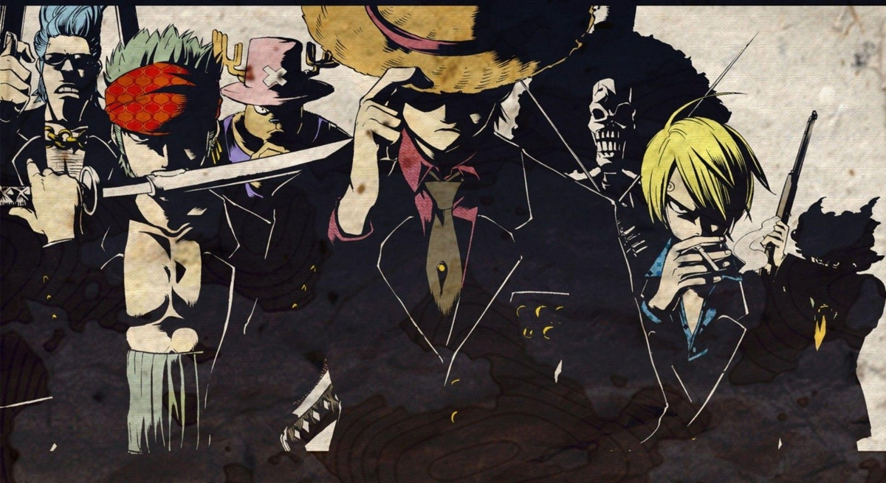

  

  

  

 

  <table>
    <tr>
      <td width="50%" align="center">
        <h3>🔮 <a href="https://github.com/Pavankombana/My-Orb">My Orb</a></h3>
        
Desktop Assistant & System Automation

        <code>Electron</code> • <code>React</code> • <code>Vite</code>
      </td>
      <td width="50%" align="center">
        <h3>🥔 <a href="https://github.com/Pavankombana/Potato_Legend_Bot">Potato Legend Bot</a></h3>
        
Discord Moderation & Minecraft Integration

        <code>Python</code> • <code>discord.py</code> • <code>AsyncIO</code>
      </td>
    </tr>
  </table>

 

  

