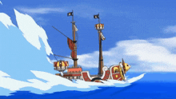

  

 

 
 

- Status: **CS Student**
- Role: **Vibe coder**
- Handle: **Pavankombana** (call me **potato**)
- Stack: **TypeScript**, **Python**, **React**, **Electron**, **Vite**

 
 
 

   
  

 

 
 

  <b>Frontend & Desktop</b> 
  
    
  <b>Backend & Systems</b> 
  
    
  <b>Tools & Environment</b> 
  

 
 

