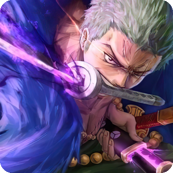
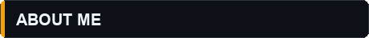
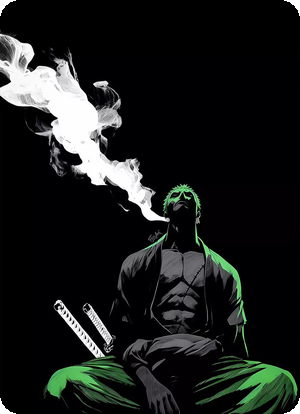
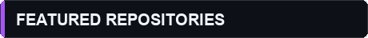
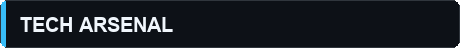
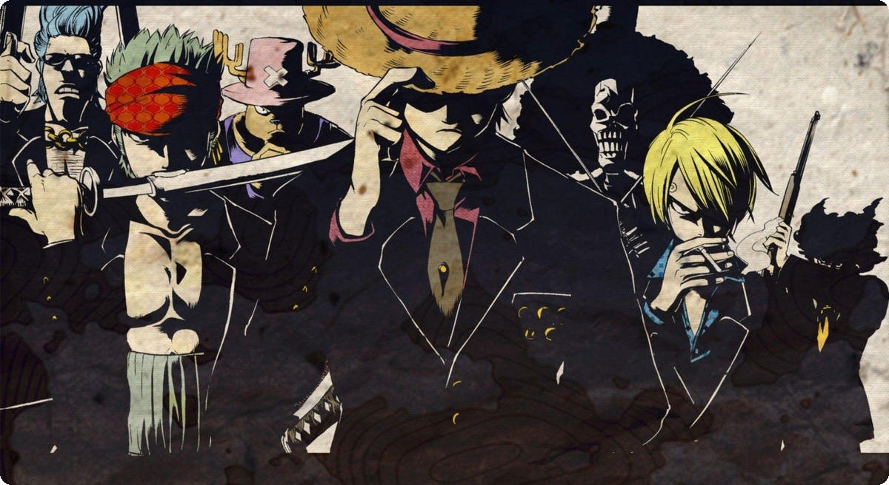

  

 

 
 

- ⚡ Vibe: **Just a vibe coder** 🎧
- 🥔 Handle: **Pavankombana** (call me **potato**)
- 🔮 Building: **My Orb** & **Potato Legend Bot**
- 🛠 Stack: **TypeScript**, **Python**, **React**, **Electron**, **Vite**
- ☕ Mood: **Building cool stuff that just works**

 
 
 

 
 

- 🔮 [***Pavankombana/My-Orb***](https://github.com/Pavankombana/My-Orb)  
  Floating desktop companion, notch app & canvas.
- 🥔 [***Pavankombana/Potato_Legend_Bot***](https://github.com/Pavankombana/Potato_Legend_Bot)  
  Discord bot with welcomers & Minecraft server integration.

 
 

 
 

  

 

