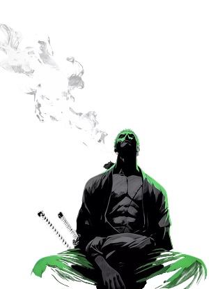

<div align="center">
  
</div>

<div>


### About Me

- Status: **CS Student**
- Role: **Vibe coder**
- Handle: **Pavankombana** (call me **potato**)
- Philosophy: **Whatever builds the vision**

```zsh
❯ potato --status
  student     : computer science
  role        : vibe coder
  philosophy  : if it runs, it ships
  currently   : vibe coding & one piece
```


### Tech Stack

<p>
  
  
  
  
  
</p>

*CS student by day, mass-vibe-coding with Antigravity by night*

<br/><br/>

<p>
  <a href="https://skillicons.dev">
    
  </a>
</p>

</div>

<br/>
<br/>

<div align="center">
  
</div>

<br/>

<p align="center">
  <a href="https://discord.com"></a> &nbsp;
  <a href="mailto:pavankombana@users.noreply.github.com"></a> &nbsp;
  <a href="https://github.com/Pavankombana"></a>
</p>
